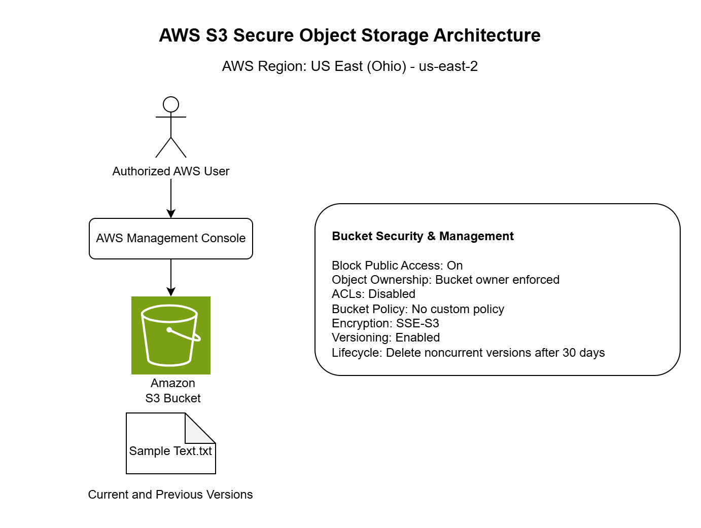
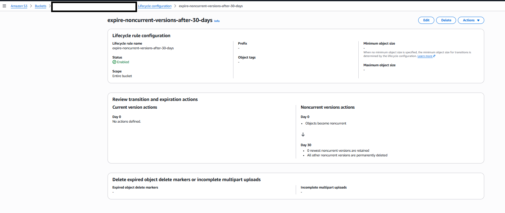

# AWS S3 Secure Object Storage Project

## Project Overview

This project demonstrates the implementation and management of an Amazon Simple Storage Service (Amazon S3) bucket using the AWS Management Console.

The project involved creating an S3 bucket, uploading and retrieving objects, reviewing security configurations, verifying server-side encryption, enabling object versioning, and configuring lifecycle management to help optimize storage costs.

Object versioning was tested to demonstrate how Amazon S3 preserves previous versions of files and supports data recovery.

The project also includes an AWS architecture diagram, implementation screenshots, and technical documentation maintained in GitHub.

**The goal of this project was to gain practical experience in AWS cloud storage, data protection, security, cost management, and technical documentation.**

## AWS Service Used

- Amazon S3

## Project Objectives
- Create and configure an Amazon S3 general purpose bucket.
- Understand AWS Region selection and its importance.
- Upload and retrieve objects from Amazon S3.
- Review S3 security settings, including Block Public Access, Object Ownership, ACLs, and bucket policies.
- Understand server-side encryption using Amazon S3-managed keys (SSE-S3).
- Enable and test S3 Object Versioning for data protection and recovery.
- Configure S3 Lifecycle Management to automatically expire noncurrent object versions after 30 days.
- Understand Amazon S3 storage costs and basic cost optimization practices.
- Create an AWS S3 architecture diagram using diagrams.net.
- Document the project using Git, GitHub, and Markdown.

## Project Architecture
- The architecture diagram illustrates how an authorized AWS user manages an Amazon S3 bucket through the AWS Management Console.
  
- The bucket is deployed in the US East (Ohio) Region and incorporates security controls, server-side encryption, object versioning, and lifecycle management.



## Implementation

### 1. Created an Amazon S3 Bucket

### 2. Uploaded an Object to Amazon S3

### 3. Retrieved an Object from Amazon S3

### 4. Reviewed S3 Block Public Access

### 5. Reviewed S3 Object Ownership and ACLs

### 6. Reviewed S3 Bucket Policy

### 7. Reviewed S3 Default Encryption

### 8. Enabled S3 Bucket Versioning

### 9. Tested S3 Object Versioning

### 10. Retrieved a Previous Object Version

### 11. Configured S3 Lifecycle Management


### 1. Created an Amazon S3 Bucket

A general purpose S3 bucket was created in the **US East (Ohio) - us-east-2** Region.

The bucket name has been hidden in the public screenshot as a privacy-conscious documentation practice.


### 2. Uploaded an Object to Amazon S3

A sample text file was uploaded to the S3 bucket to verify that the bucket could successfully store objects.

The upload completed successfully, confirming that the bucket was functioning as intended.


### 3. Retrieved an Object from Amazon S3
- The previously uploaded text file was downloaded from the S3 bucket to verify that stored objects could be successfully retrieved.
  
- The downloaded file was opened locally and its contents were verified, confirming the basic Amazon S3 object storage workflow:
  
- **Upload → Store → Retrieve**


### 4. Reviewed S3 Block Public Access
- I reviewed the S3 bucket's public access settings and confirmed that **Block all public access** was enabled.
  
- All four individual Block Public Access settings were enabled to help prevent unintended public access through access control lists (ACLs) and bucket policies.
  
- The bucket was kept private because this project did not require anonymous or public access to its objects.
  
**Key learning** Cloud storage should remain private by default, and access should only be granted when there is a legitimate requirement.


### 5. Reviewed S3 Object Ownership and ACLs
- I reviewed the S3 bucket's Object Ownership setting and confirmed that **Bucket owner enforced** was enabled.
  
- With this configuration, access control lists (ACLs) are disabled, and the bucket-owning AWS account owns the objects stored in the bucket.
  
- Access to the bucket and its objects is managed through policies, such as IAM policies and S3 bucket policies, rather than ACLs.
  
**Key learning** Using Bucket owner enforced, simplifies ownership and helps centralize access management through policies.


### 6. Reviewed S3 Bucket Policy
- I reviewed the S3 bucket's resource-based policy configuration and confirmed that no custom bucket policy was attached.
  
- The AWS Management Console displayed **No policy to display**, while confirming that public access was blocked.
  
- The project did not require a custom bucket policy because no additional users, applications, or public identities needed access to the stored objects.
  
- Authorized access to the bucket can be managed through AWS Identity and Access Management (IAM) policies without creating a public bucket policy.
  
**Key learning** A bucket does not need a custom bucket policy to function. Permissions should be granted only when there is a specific access requirement.


### 7. Reviewed S3 Default Encryption
- I reviewed the S3 bucket's default encryption setting and confirmed that **Server-side encryption with Amazon S3 managed keys (SSE-S3)** was enabled.
  
- With SSE-S3, Amazon S3 automatically encrypts objects before storing them and decrypts them when authorized users retrieve them.
  
- The configuration also showed that **S3 Bucket Key** was enabled and **SSE-C (customer-provided encryption keys)** was blocked.
  
- SSE-S3 was suitable for this project because it provides encryption at rest without requiring me to create or manage encryption keys manually.
**Key learning** Encryption at rest protects stored data, while access controls determine who is authorized to access the data. Both are important parts of cloud security.


### 8. Enabled S3 Bucket Versioning
- I enabled S3 Bucket Versioning to protect stored objects against accidental overwrites and deletions.
  
- Versioning allows Amazon S3 to preserve multiple versions of an object when a new file is uploaded using the same object key (filename).

- Before enabling versioning, I confirmed that the bucket's versioning status was **Disabled**. I then enabled the feature through the AWS Management Console.

- This configuration prepared the bucket for testing how Amazon S3 retains and recovers previous versions of stored objects.
  
**Key learning** S3 Versioning helps protect data by preserving earlier object versions. However, each retained version consumes storage and can increase costs.


### 9. Tested S3 Object Versioning
- To test S3 Versioning, I modified the contents of the previously uploaded 'Sample Text.txt' file and uploaded it again to the same S3 bucket using the same object name.
  
- I then enabled **Show versions** in the S3 console to examine the stored object versions.
  
- The test confirmed that Amazon S3 retained both versions:
  
- **Original version:** 72.0 B, uploaded before versioning was enabled, with a version ID of 'null'.
  
- **Modified version:** 133 B, uploaded after versioning was enabled, with a unique version ID.
  
- The modified version became the current version, while the original version was preserved as a noncurrent version.
  
**Key learning** S3 Versioning preserves previous versions of an object when new content is uploaded using the same object key. This helps protect against accidental overwrites and object recovery.


### 10. Retrieved a Previous Object Version
- To test object recovery, I used Amazon S3 Versioning to retrieve the original version of Sample Text.txt after uploading a modified version.
  
- I enabled the **Show versions** in the S3 console and identified the original object using its version ID of null and file size of 72.0 B.
  
- I selected the original version and downloaded it to my local computer. I then opened the downloaded file to verify that its original contents have been preserved.
  
- This demonstrated that Amazon S3 can retain and retrieve earlier versions of objects even after newer versions have been uploaded.
  
**Key learning** S3 Versioning supports data recovery by preserving previous object versions. This is useful when files are accidentally overwritten or modified. Downloading an older version does not automatically make it the current version in S3.


### 11. Configured S3 Lifecycle Management
- I configured an Amazon S3 Lifecycle rule to automatically manage older versions of objects stored in the bucket.
  
- The lifecycle rule was named expire-noncurrent-versions-after-30-days and was configured with the following settings:
- **Rule status:** Enabled
- **Rule scope:** All objects in the bucket
- **Lifestyle action:** Permanently delete noncurrent object versions
- **Retention period:** 30 days after an object version becomes noncurrent
- **Number of newer noncurrent versions retained:** 0
- **Current object versions:** No expiration action configured
  
- With this configuration, Amazon S3 identifies noncurrent object versions that have reached the 30-day threshold and makes them eligible for permanent deletion through lifecycle processing.
  
- The rule does not expire the current version of an object.
  
- This configuration helps manage storage consumption by preventing unnecessary accumulation of older object versions.
  
**Key learning** S3 Lifecycle Management helps automate storage management and control costs. However, lifecycle expiration must be configured carefully because permanently deleted object versions cannot be recovered.


## Security Considerations
Security was an important consideration throughout this Amazon S3 project. I reviewed the bucket's security settings and maintained configurations that help protect stored objects from unauthorized access.

### 1. Block Public Access
I confirmed that **Block all public access** was enabled, including all four individual protection settings. This helps prevent accidental public exposure through ACL and bucket policies.
### 2. Object Ownership and ACLs
The bucket uses **Bucket owner enforced** Object Ownership, with Access Control Lists (ACLs) disabled. This allows object access to be managed through policies rather than ACL permissions.
### 3. Bucket Policy
I reviewed the bucket policy configuration and confirmed that **no custom bucket policy** was attached. The project did not require public access or additional resource-based permissions.
### 4. Encryption at Rest
The bucket uses **Server-Side Encryption with Amazon S3 Managed Keys (SSE-S3)**. This automatically encrypts objects stored in Amazon S3 without requiring manual encryption key management.
### 5. Object Versioning and Recovery
I enabled **S3 Versioning** and verified that earlier versions of objects could be preserved. This supports recovery from accidental overwrites and modifications.
### 6. Lifecycle Management
I configured a lifecycle rule to permanently delete noncurrent object versions after **30 days**. This helps manage storage costs while providing a defined recovery window. The retention period must be appropriate for the data being stored.
### 7. Credential Protection
I understand that AWS access keys, secret access keys, passwords, and other credentials must not be included in public GitHub repositories. Also, project screenshots should be reviewed to avoid exposing sensitive account information.
**Key security principle:** Keep cloud resources private by default and grant only the access required for legitimate operations.


## Cost Management
Cost management was an important consideration throughout this Amazon S3 project. I explored how AWS storage usage, object requests, versioning, and lifecycle management can affect cloud costs.

### 1. Amazon S3 Storage Costs
Amazon S3 pricing depends on factors such as the amount of data stored, storage class, duration of storage, request, and applicable data transfer charges.
For this project, I used the **S3 Standard** storage class and uploaded small text files to keep storage requirements minimal.
### 2. Object Versioning and Storage Costs
I enabled S3 Versioning to preserve previous versions of stored objects.
During testing, Amazon S3 retained the original 72-byte object and the modified 133-byte object.
Each retained version consumes storage because Amazon S3 stores complete object versions rather than only the differences between them.
**Key learning** Versioning improves data recovery capabilities but may increase storage costs as additional versions accumulate.
### 3. Lifecycle Management for Cost Optimization
To help manage costs, I configured an S3 Lifecycle rule named expire-noncurrent-versions-after-30-days.
The rule automatically makes noncurrent object versions eligible for permanent deletions after they have been noncurrent for 30 days.
The rule does not expire current object versions.
This demonstrates how lifecycle policies can automate the removal of unnecessary historical data and reduce long-term storage consumption.
### 4. Cost Monitoring
AWS Billing and Cost Management provides tools for monitoring cloud spending. AWS Budgets can also be used to set spending thresholds and receive alerts.
For future projects, monitoring resource usage and reviewing estimated charges will be important practices for avoiding unexpected costs.
### 5. Cost Management Lessons
- Use small datasets when learning AWS services.
- Understand which cloud activities generate charges.
- Remember that each S3 object version consumes storage.
- Use lifecycle rules to manage unnecessary object versions.
- Monitor AWS usage and spending regularly.
- Remove resources that are no longer needed.
**Key learning** Effective cloud engineering involves balancing performance, data protection, availability, and cost efficiency.


## Lessons Learned  

Completing this Amazon S3 project provided practical experience with AWS cloud storage, security, data protection, lifecycle management, GitHub, and technical documentation.

The following are the key lessons I learned throughout the project.

### 1. Understanding Amazon S3 Object Storage

I learned that Amazon S3 is an object storage service used to store and retrieve data in the cloud.

Through this project, I learned how to:

- Create an Amazon S3 general purpose bucket.
- Select an AWS Region for cloud resources.
- Upload objects to an S3 bucket.
- Download stored objects to a local computer.
- Understand the difference between an S3 bucket and an S3 object.

**Key lesson:** Amazon S3 provides scalable object storage, allowing users and applications to store and retrieve data without managing physical storage infrastructure.

### 2. Understanding Cloud Security and Access Control

I learned the importance of securing cloud storage resources and preventing unintended public access.

I reviewed the following security configurations:

- Block Public Access
- Object Ownership
- Access Control Lists (ACLs)
- Bucket policies
- Server-side encryption using SSE-S3

I also learned that keeping a bucket private does not prevent authorized AWS identities from accessing it.

**Key lesson:** Cloud resources should remain private by default, and permissions should be granted only when there is a legitimate access requirement.

### 3. Understanding Object Versioning and Data Recovery

I learned how Amazon S3 Versioning preserves multiple versions of objects stored in the same bucket.

I enabled versioning and tested the feature by uploading a modified version of an existing text file.

The experiment demonstrated that S3 could preserve both the original and modified versions of the same object.

I also learned how previous object versions can be identified and retrieved when needed.

**Key lesson:** Versioning helps protect against accidental overwrites and supports data recovery, but retained versions consume additional storage.

### 4. Understanding Lifecycle Management

I learned how S3 Lifecycle rules can automate the management of stored objects.

I configured a lifecycle rule to permanently delete noncurrent object versions after 30 days.

This demonstrated how organizations can define retention periods and reduce unnecessary storage consumption.

**Key lesson:** Lifecycle management helps balance data recovery requirements with storage costs. Retention periods must be selected carefully because permanently deleted versions cannot be recovered.

### 5. Understanding Cloud Cost Management

I learned that cloud storage costs are influenced by several factors, including:

- Amount of data stored
- Storage class
- Object requests
- Data transfer
- Number of retained object versions

I also learned why small test files are suitable for beginner cloud projects and why unused resources should be reviewed regularly.

**Key lesson:** Cloud engineers must consider resource costs alongside functionality, security, and reliability.

### 6. Learning Git and GitHub for Project Documentation

I gained practical experience using GitHub to document an AWS cloud project.

Throughout the project, I learned how to:

- Create a GitHub repository.
- Organize project files into folders.
- Use GitHub Desktop to commit and push changes.
- Write meaningful commit messages.
- Edit a README using Markdown.
- Embed project screenshots using relative file paths.
- Correct files that were uploaded to the wrong repository folder.
- Maintain an organized record of project development.

**Key lesson:** Git and GitHub support version control, collaboration, and professional documentation of technical projects.

### 7. Learning Cloud Architecture Documentation

I learned how to create a basic cloud architecture diagram using diagrams.net.

The diagram illustrates the relationship between the authorized AWS user, AWS Management Console, Amazon S3 bucket, stored objects, and security configurations.

I also learned how to save an editable `.drawio` file and export a PNG image for GitHub documentation.

**Key lesson:** Architecture diagrams help communicate how cloud components interact and make technical projects easier to understand.

### 8. Developing Troubleshooting and Problem-Solving Skills

Throughout the project, I encountered and worked through practical challenges involving GitHub Desktop, repository organization, README formatting, Markdown image links, and architecture diagram creation.

These challenges helped me improve my ability to investigate problems, identify their causes, and make corrections.

**Key lesson:** Cloud engineering involves more than configuring services. Troubleshooting, testing, documentation, and continuous learning are equally important.

## Overall Project Reflection

This project helped me progress from understanding basic AWS concepts to performing practical cloud storage operations.

I gained experience with object storage, security configurations, encryption, versioning, lifecycle management, cloud cost awareness, GitHub documentation, and basic architecture design.

Most importantly, I learned the value of understanding **why a cloud configuration is necessary**, rather than simply knowing which buttons to click in the AWS Management Console.

## Challenges and Troubleshooting

During this AWS S3 project, I encountered several challenges involving project documentation, GitHub repository management, Markdown formatting, and cloud architecture visualization.

Resolving these challenges helped me develop practical troubleshooting skills and understand the importance of verifying technical configurations and documentation.

### 1. GitHub README Images Not Displaying

**Challenge:** An architecture diagram did not display correctly in the GitHub README preview.

**Cause:** The Markdown image reference pointed to the `architecture` folder, but the PNG file had been uploaded to the `screenshots` folder. I also encountered a Markdown formatting issue involving an extra backslash before the image path.

**Resolution:**

- Reviewed the Markdown image syntax.
- Confirmed the correct image filename and folder.
- Moved `s3-architecture.png` into the `architecture` folder.
- Corrected the README image reference:

```markdown

```

**Key learning:** Markdown image references must match the actual repository folder structure and filenames.

### 2. Correcting File Organization in GitHub

**Challenge:** The architecture diagram was uploaded to the wrong folder after being committed.

**Cause:** The file was placed inside `screenshots` instead of `architecture`.

**Resolution:**

- Opened the local repository through GitHub Desktop.
- Moved the PNG file into the correct folder using Windows File Explorer.
- Verified that GitHub Desktop detected the old path as deleted and the new path as added.
- Committed and pushed the correction.

**Key learning:** Version control tracks changes to file locations, and maintaining a clear repository structure improves project organization.

### 3. Understanding GitHub Desktop Warnings

**Challenge:** GitHub Desktop displayed a warning about LF and CRLF line endings when adding the editable `.drawio` architecture file.

**Cause:** The diagram file used LF line endings, while Git was configured to convert them to Windows-style CRLF line endings during checkout.

**Resolution:**

- Reviewed the warning to understand its meaning.
- Confirmed that it was informational rather than evidence of a damaged file.
- Continued with the commit without making unnecessary changes to Git configuration.

**Key learning:** Not every warning indicates a failure. Understanding the message helps determine whether corrective action is necessary.

### 4. Learning Markdown Formatting

**Challenge:** Some headings appeared smaller than others, and I initially found it difficult to format bullet points, bold text, and image links.

**Cause:** Markdown uses specific symbols to define formatting, including heading levels, lists, emphasis, and image references.

**Resolution:**

- Used three hashtags (`###`) consistently for numbered implementation headings.
- Used a hyphen followed by a space (`- `) to create bullet points.
- Used double asterisks (`**`) to make text bold.
- Used GitHub's Preview feature to verify formatting before committing changes.

**Key learning:** Clear and consistent technical documentation requires understanding basic Markdown syntax.

### 5. Creating the AWS Architecture Diagram

**Challenge:** I initially had difficulty locating AWS shapes, positioning components, adding labels, and connecting shapes in diagrams.net.

**Cause:** The diagramming application was unfamiliar, and some connection arrows and editing controls were not immediately visible.

**Resolution:**

- Enabled the AWS shape library.
- Added the Amazon S3 icon and an authorized user figure.
- Used a rounded rectangle to represent the AWS Management Console.
- Added connectors to show the interaction between the user, console, and S3 bucket.
- Added a security and management information box.
- Adjusted spacing and alignment to improve readability.
- Exported the final diagram as a PNG and retained the editable `.drawio` file.

**Key learning:** Architecture diagrams require clear component relationships, appropriate labels, and consistent visual organization.

### 6. Understanding S3 Object Versioning

**Challenge:** After uploading a modified object, I needed to identify the original and updated versions of the same file.

**Cause:** S3 normally displays the current object view unless object versions are explicitly shown.

**Resolution:**

- Enabled **Show versions** in the S3 console.
- Identified the original object with a `null` version ID.
- Identified the modified object using its unique version ID.
- Confirmed that the earlier object remained stored as a noncurrent version.

**Key learning:** Testing a cloud feature and examining its results are essential for understanding how it behaves.

## Overall Troubleshooting Reflection

This project reinforced the importance of checking configurations, interpreting system messages, verifying file locations, and testing results before considering a task complete.

I also learned that technical troubleshooting involves identifying the source of a problem and applying a specific correction rather than making unnecessary changes.

These experiences strengthened my confidence in working with AWS, GitHub, Markdown, and cloud architecture documentation.

## Cleanup and Project Completion

### 1. Importance of AWS Resource Cleanup

Cloud resources should be reviewed and removed when they are no longer required.

Although this project uses small text files, unused AWS resources may continue to generate costs depending on their configuration and usage.

Proper resource cleanup is therefore an important part of cloud cost management.

### 2. Understanding Cleanup in a Versioning-Enabled Bucket

Amazon S3 Versioning preserves multiple versions of an object.

When versioning is enabled, deleting an object without specifying a version ID normally creates a delete marker rather than permanently deleting all stored versions.

As a result, previous versions may continue occupying storage and generating storage charges.

**Key learning:** Deleting the current view of an S3 object does not necessarily remove all versions of that object.

### 3. Planned Resource Cleanup Procedure

When the learning environment is no longer required, the following procedure will be used:

1. Sign in to the AWS Management Console.
2. Navigate to Amazon S3.
3. Select the project bucket.
4. Review the objects, object versions, and delete markers.
5. Confirm that any required files or earlier versions have been downloaded or backed up.
6. Use the S3 **Empty** bucket operation to permanently remove all objects, versions, and delete markers.
7. Verify that the bucket is empty.
8. Delete the bucket if it is no longer needed.
9. Review AWS Billing and Cost Management for any remaining usage or charges.

**Important:** Emptying an S3 bucket permanently deletes its contents, including previous object versions. This action cannot be undone.

### 4. Lifecycle Management and Cleanup

A lifecycle rule named `expire-noncurrent-versions-after-30-days` was configured during this project.

The rule automatically makes noncurrent object versions eligible for permanent deletion after they have been noncurrent for 30 days.

However, this rule does not expire current object versions and is not a substitute for completely emptying and deleting the bucket when the learning environment is retired.

### 5. Project Completion Status

**Technical implementation:** Completed

**Architecture and documentation:** Completed

**Resource cleanup:** Pending — the S3 bucket is being retained temporarily for further AWS learning.

The project demonstrated practical experience with:

- Amazon S3 bucket creation and object storage
- Object uploading and retrieval
- S3 security and permissions review
- Server-side encryption with SSE-S3
- Object versioning and recovery
- Lifecycle management
- AWS architecture diagram creation
- Git and GitHub project documentation

The project will be considered fully closed once the resources are no longer needed, cleanup has been completed, and the final repository review has been performed.

### 6. Final Project Reflection

This project provided an opportunity to apply AWS cloud storage concepts in a practical environment.

It also reinforced the importance of securing cloud resources, protecting stored data, managing costs, verifying configurations, maintaining technical documentation, and planning for resource cleanup.

The knowledge gained provides a foundation for more advanced AWS projects involving identity and access management, compute, networking, monitoring, and infrastructure automation.

## Skills Demonstrated

- Amazon S3 bucket creation and configuration
- AWS Management Console navigation
- Cloud object storage and retrieval
- S3 Block Public Access and Object Ownership
- S3 bucket policies and access control fundamentals
- Server-side encryption (SSE-S3)
- S3 Object Versioning and recovery
- S3 Lifecycle Management
- Cloud storage cost management fundamentals
- Git and GitHub version control
- GitHub Desktop and Markdown documentation
- Cloud architecture diagramming using diagrams.net
- Technical troubleshooting and problem-solving


## Project Status

**Technical Implementation:** Completed

**Documentation:** Final review in progress

**Resource Cleanup:** Pending - S3 bucket retained for future AWS learning.
