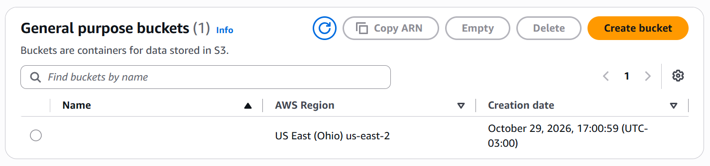
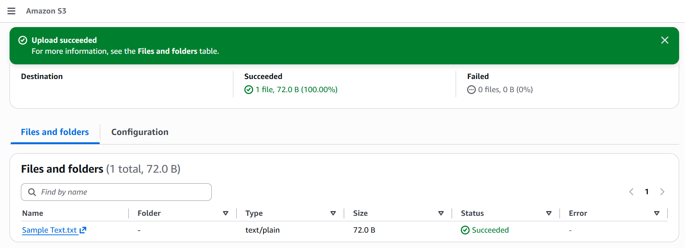
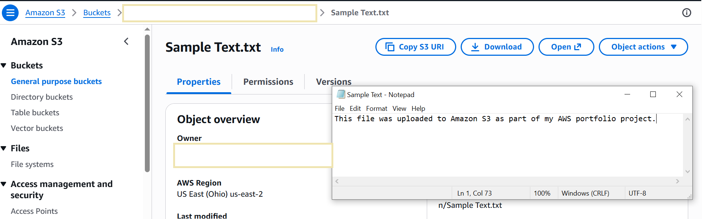
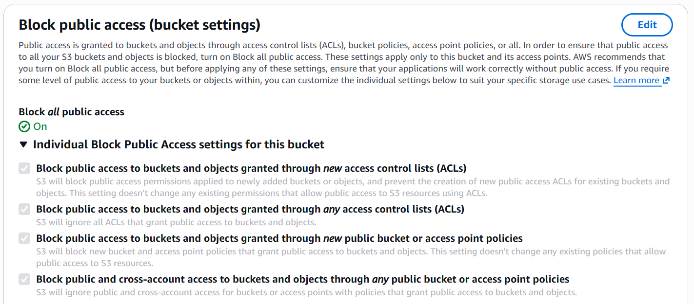
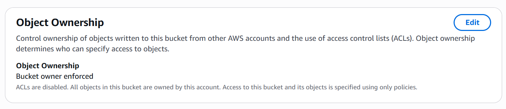
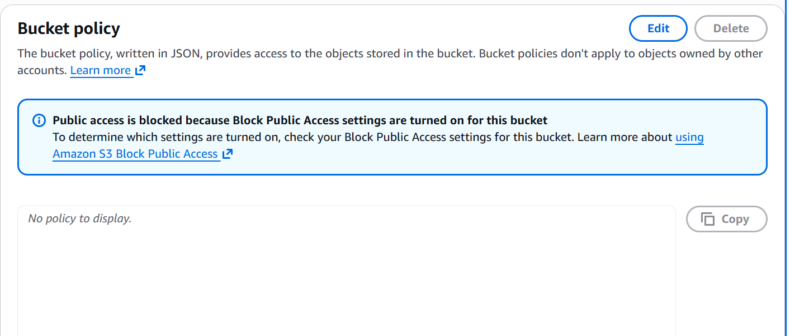
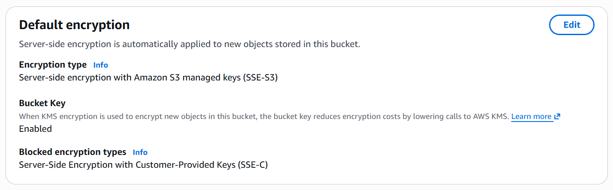
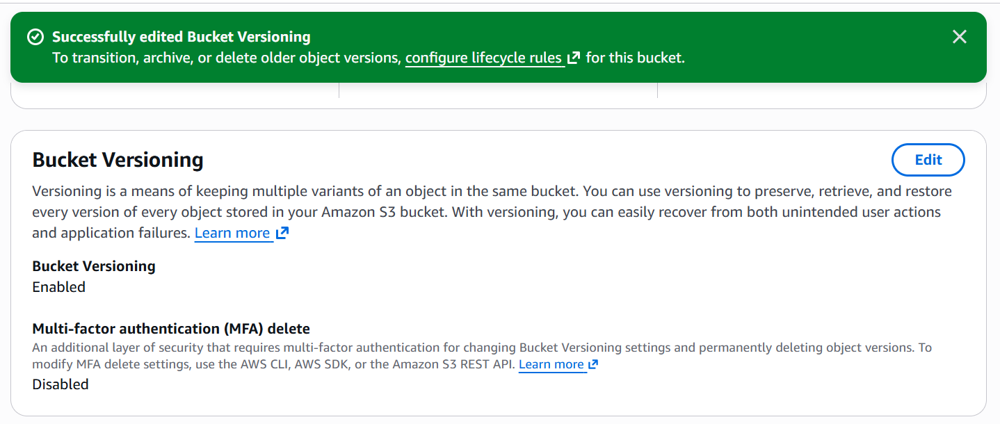
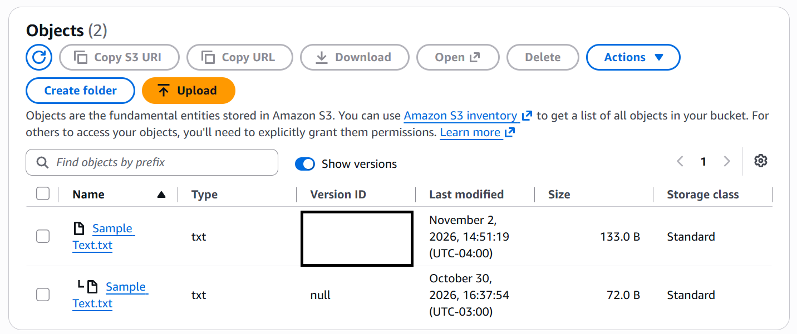
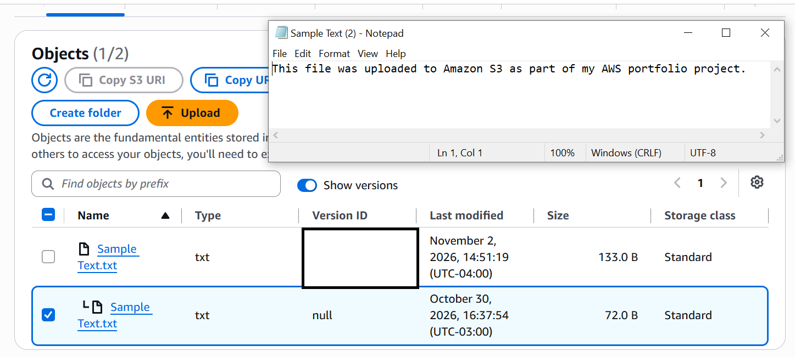

# AWS S3 Static Storage Project

## Project Overview

This project demonstrates the creation and use of an Amazon Simple Storage Service (Amazon S3) bucket using the AWS Management Console.

The objective is to gain hands-on experience with cloud object storage, basic security practices, and technical documentation.

## AWS Service Used

- Amazon S3

## Project Objectives

- Create an Amazon S3 general purpose bucket
- Understand AWS Region selection
- Upload objects to S3
- Retrieve objects from S3
- Review bucket security and permissions
- Document the project using GitHub

## Implementation

### 1. Created an Amazon S3 Bucket

A general purpose S3 bucket was created in the **US East (Ohio) - us-east-2** Region.

The bucket name has been hidden in the public screenshot as a privacy-conscious documentation practice.

### 2. Uploaded an Object to Amazon S3

A sample text file was uploaded to the S3 bucket to verify that the bucket could successfully store objects.

The upload completed successfully, confirming that the bucket was functioning as intended.

- ### 3. Retrieved an Object from Amazon S3
- The previously uploaded text file was downloaded from the S3 bucket to verify that stored objects could be successfully retrieved.
- The downloaded file was opened locally and its contents were verified, confirming the basic Amazon S3 object storage workflow:
- **Upload → Store → Retrieve**

- 

- ### 4. Reviewed S3 Block Public Access
- I reviewed the S3 bucket's public access settings and confirmed that **Block all public access** was enabled.
- All four individual Block Public Access settings were enabled to help prevent unintended public access through access control lists (ACLs) and bucket policies.
- The bucket was kept private because this project did not require anonymous or public access to its objects.
- **Key learning** Cloud storage should remain private by default, and access should only be granted when there is a legitimate requirement.
- 

- ### 5. Reviewed S3 Bucket Ownership and ACLs
- I reviewed the S3 bucket's Object Ownership setting and confirmed that **Bucket owner enforced** was enabled.
- With this configuration, access control lists (ACLs) are disabled, and the bucket-owning AWS account owns the objects stored in the bucket.
- Access to the bucket and its objects is managed through policies, such as IAM policies and S3 bucket policies, rather than ACLs.
- **Key learning** Using Bucket owner enforced, simplifies ownership and helps centralize access management through policies.
- 

- ### 6. Reviewed S3 Bucket Policy
- I reviewed the S3 bucket's resource-based policy configuration and confirmed that no custom bucket policy was attached.
- The AWS Management Console displayed **No policy to display**, while confirming that public access was blocked.
- The project did not require a custom bucket policy because no additional users, applications, or public identities needed access to the stored objects.
- Authorized access to the bucket can be managed through AWS Identity and Access Management (IAM) policies without creating a public bucket policy.
- **Key learning** A bucket does not need a custom bucket policy to function. Permissions should be granted only when there is a specific access requirement.
- 

- ### 7. Reviewed S3 Default Encryption
- I reviewed the S3 bucket's default encryption setting and confirmed that **Server-side encryption with Amazon S3 managed keys (SSE-S3)** was enabled.
- With SSE-S3, Amazon S3 automatically encrypts objects before storing them and decrypts them when authorized users retrieve them.
- The configuration also showed that **S3 Bucket Key** was enabled and **SSE-C (customer-provided encryption keys)** was blocked.
- SSE-S3 was suitable for this project because it provides encryption at rest without requiring me to create or manage encryption keys manually.
- **Key learning** Encryption at rest protects stored data, while access controls determine who is authorized to access the data. Both are important parts of cloud security.
- 

- ### 8. Enabled S3 Bucket Versioning
- I enabled S3 Bucket Versioning to protect stored objects against accidental overwrites and deletions.
- Versioning allows Amazon S3 to preserve multiple versions of an object when a new file is uploaded using the same object key (filename).
- Before enabling versioning, I confirmed that the bucket's versioning status was **Disabled**. I then enabled the feature through the AWS Management Console.
- This configuration prepared the bucket for testing how Amazon S3 retains and recovers previous versions of stored objects.
- **Key learning** S3 Versioning helps protect data by preserving earlier object versions. However, each retained version consumes storage and can increase costs.
- 

- ### 9. Tested S3 Object Versioning
- To test S3 Versioning, I modified the contents of the previously uploaded 'Sample Text.txt' file and uploaded it again to the same S3 bucket using the same object name.
- I then enabled **Show versions** in the S3 console to examine the stored object versions.
- The test confirmed that Amazon S3 retained both versions:
- **Original version:** 72.0 B, uploaded before versioning was enabled, with a version ID of 'null'.
- **Modified version:** 133 B, uploaded after versioning was enabled, with a unique version ID.
- The modified version became the current version, while the original version was preserved as a noncurrent version.
- **Key learning** S3 Versioning preserves previous versions of an object when new content is uploaded using the same object key. This helps protect against accidental overwrites and object recovery.
- 

- ### 10. Retrieved a Previous Object Version
- To test object recovery, I used Amazon S3 Versioning to retrieve the original version of Sample Text.txt after uploading a modified version.
- I enabled the **Show versions** in the S3 console and identified the original object using its version ID of null and file size of 72.0 B.
- I selected the original version and downloaded it to my local computer. I then opened the downloaded file to verify that its original contents have been preserved.
- This demonstrated that Amazon S3 can retain and retrieve earlier versions of objects even after newer versions have been uploaded.
- **Key learning** S3 Versioning supports data recovery by preserving previous object versions. This is useful when files are accidentally overwritten or modified. Downloading an older version does not automatically make it the current version in S3.
- 

## Security Considerations

- AWS access keys and secret access keys are not stored in this repository.
- Sensitive account information is excluded from screenshots.
- The S3 bucket name is hidden where it is not necessary for demonstrating the project.
- Public-access settings will be reviewed carefully before making any object publicly accessible.

## Skills Demonstrated

- Amazon S3
- AWS Management Console
- Cloud storage fundamentals
- Basic AWS security practices
- Git
- GitHub
- Technical documentation

## Project Status

In Progress
